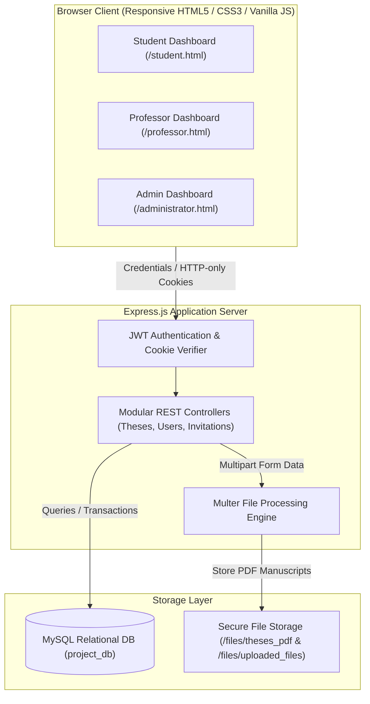

# 🎓 Academic Thesis & Role Management Platform

[](https://nodejs.org/)
[](https://expressjs.com/)
[](https://www.mysql.com/)
[](https://jwt.io/)
[](https://github.com/expressjs/multer)
[](LICENSE)

A robust full-stack web application designed to digitize, streamline, and automate the academic thesis lifecycle at the university level (CEID, University of Patras). The platform enforces **Role-Based Access Control (RBAC)** across three distinct academic actors: **Students**, **Professors**, and **Department Administrators**, backed by secure JWT authentication and a relational MySQL architecture.

---

## 🌟 Key Features & Workflow

### 1. 👥 Tri-Role Access Control (RBAC)
- **👨‍🎓 Student Portal:**
  - Browse assigned and unassigned thesis topics across research domains.
  - Submit digital applications for available topics with motivation statements.
  - Multi-part document upload for draft deliverables and final thesis manuscripts (PDF).
  - Real-time progress tracking: application review, committee formation, defense readiness, and final grade publication.
- **👨‍🏫 Professor Portal:**
  - Author and publish new diploma thesis topics with topic outlines and prerequisites.
  - Review student applications (accept/reject workflows).
  - Form the 3-member examination committee by dispatching invitations to peer faculty.
  - Set defense dates, activate grading rubrics, and submit final evaluation scores.
- **🏛️ Department Administrator / Secretariat Portal:**
  - Department-wide supervision of all active, under-review, and completed theses.
  - Administrative committee assignment and role verification.
  - Repository archiving with official institutional repository links (e.g., Nemertes).
  - Aggregate statistics and progress reporting across academic semesters.

### 2. 🔐 Security & Architecture
- **Stateless & Session Authentication:** Secure authentication powered by JSON Web Tokens (JWT) transmitted via `HTTP-only` cookies to mitigate XSS and CSRF vulnerabilities.
- **Robust Multi-part File Pipeline:** Automated upload, naming, and storage of thesis PDFs using `Multer` with strict file-type validation.
- **Normalized Relational Schema:** Normalized MySQL schema (`project_db`) linking student registries, faculty members, examination committees, invitations, and deliverables.

---

## 🏛️ System Architecture



---

## 📂 Project Structure

```plaintext
academic-thesis-management/
├── er/                         # Entity-Relationship diagrams & documentation
├── files/                      # Managed thesis PDF documents
│   ├── theses_pdf/             # Published thesis topic briefs
│   └── uploaded_files/         # Student-submitted draft & final manuscripts
├── mysql_server/
│   └── init.sql                # Relational database schema & table definitions
├── provided_data/
│   └── data.json               # Seed data for academic registries & professors
├── protected_views/            # Role-gated dashboard views (Student, Prof, Admin)
│   ├── administrator.html
│   ├── professor.html
│   └── student.html
├── public/                     # Public assets, stylesheets & client scripts
│   ├── javascript/             # Dynamic client controller logic
│   └── images/                 # UI assets and iconography
├── views/                      # Unauthenticated public views
│   ├── login.html              # Centralized role login portal
│   └── announcements.html      # Public thesis announcements feed
├── config.js                   # MySQL connection pooling & data seeder
├── server.js                   # Core Express application & REST routes
├── .env.example                # Environment variables template
├── .gitignore                  # Production Node.js ignore rules
└── package.json                # Project dependencies and startup scripts
```

---

## 🚀 Quick Start Guide

### Prerequisites
- **Node.js:** `v18.0.0` or higher & `npm`
- **MySQL Server:** `v8.0` or higher

---

### Step 1: Clone Repository
```bash
git clone https://github.com/Mamel11/academic-thesis-management.git
cd academic-thesis-management
```

### Step 2: Database Initialization
1. Ensure your local MySQL server is active.
2. Execute the initialization script:
   ```bash
   mysql -u root -p < mysql_server/init.sql
   ```
   *This creates the `project_db` schema and sets up all relational constraints.*

---

### Step 3: Install Dependencies
```bash
npm install
```

---

### Step 4: Environment Configuration
Create your local environment file:
```bash
cp .env.example .env
```
Update `.env` with your local MySQL credentials:
```env
PORT=3000
DB_HOST=localhost
DB_USER=root
DB_PASSWORD=your_mysql_password
DB_NAME=project_db
JWT_SECRET=your_jwt_secret_key_here
```

---

### Step 5: Start the Server
```bash
npm start
```

Navigate to: **`http://localhost:3000`** in your browser.

---

## 📜 Authors & Acknowledgments

- **Emmanouela Xenou** ([@Mamel11](https://github.com/Mamel11)) - *Computer Engineering & Informatics Department (CEID), University of Patras*

---

## 📄 License
This project is open-source and available under the [MIT License](LICENSE).
